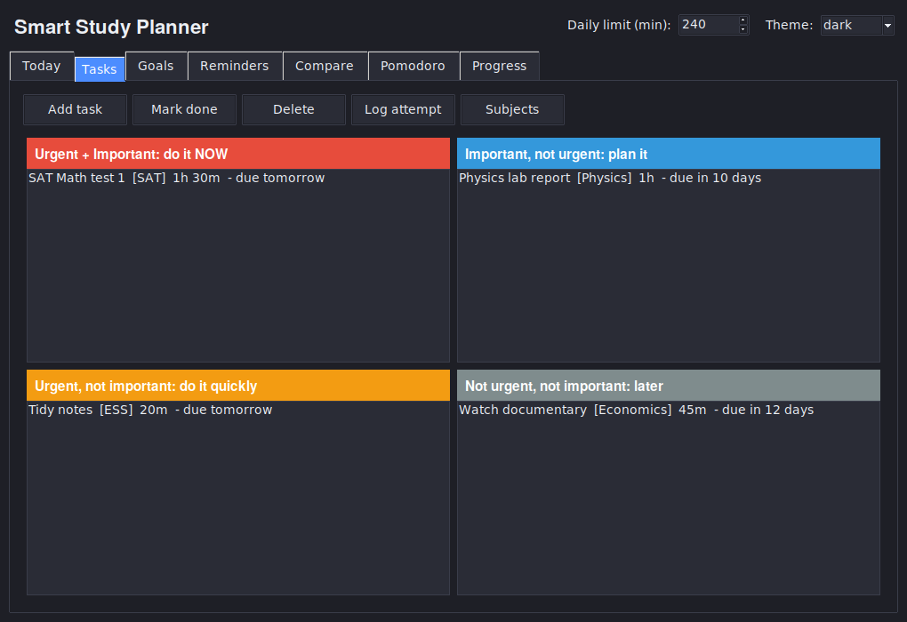
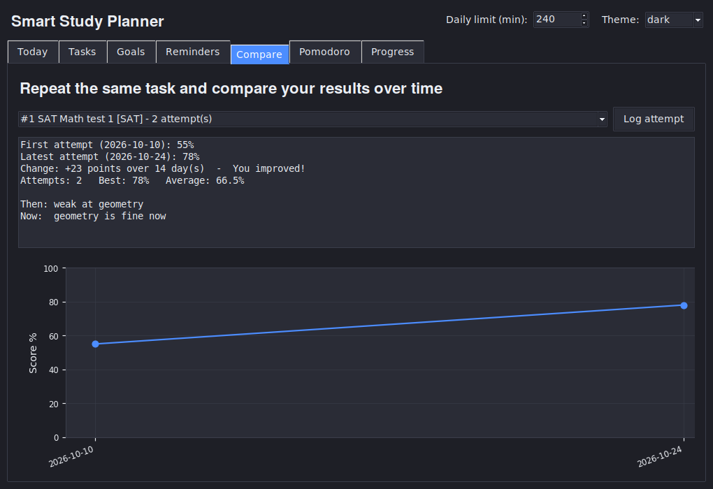

# Smart Study Planner

A desktop study planner written in Python (Tkinter). It sorts your tasks with the
Eisenhower matrix, builds a realistic plan for today, tracks your focus time with a
Pomodoro timer, and lets you repeat the same task over time to see how much you improved.



## Features

- **Eisenhower matrix**: every task lands in one of four quadrants (urgent / important).
  Urgency is detected automatically: a task is urgent when its deadline is 2 days away or closer.
- **Today view**: an automatic plan for today that fits your daily time limit.
  Tasks that do not fit are listed separately.
- **Time per task + overload warning**: enter how many minutes a task needs. If the work due on
  one day is more than your daily limit, the app warns you.
- **Pomodoro timer**: focused work and break blocks (25/5 by default, adjustable).
  Finished work blocks are saved and counted per subject.
- **Compare attempts**: do the same task again later, log your score (0-100) and a short note,
  and see your first result versus your latest result, the change in points, and a chart.
  You can set a reminder to repeat the task after a number of days.
- **Subjects**: add or remove any subjects, not only IB ones.
- **Goals**: short-term and long-term goals with optional target dates.
- **Reminders**: custom reminders. Finishing a task automatically adds review reminders
  after 1, 3 and 7 days (spaced repetition).
- **Progress**: progress bars per subject, a streak of active days, and focused minutes.
- **Light and dark theme**, saved between sessions.
- **Automatic saving** to a local JSON file.



## Installation

You need Python 3.9 or newer.

```bash
git clone <https://github.com/Kamolchik21/Study-planner.git>
cd Study-planner
pip install -r requirements.txt
python main.py
```

`matplotlib` is only used for the chart in the Compare tab. The app still works without it.

Tkinter comes with Python on Windows and macOS. On Linux install it with:

```bash
sudo apt install python3-tk
```

## How it works

| Part | Rule |
|------|------|
| Urgent task | deadline is within 2 days (overdue tasks count as urgent) |
| Today plan | urgent tasks, plus important tasks due within 7 days; sorted by quadrant and deadline; filled until the daily limit is reached |
| Overload warning | total minutes of unfinished tasks with the same deadline is greater than the daily limit |
| Review reminders | created at 09:00, 1, 3 and 7 days after a task is marked done |
| Streak | consecutive days with at least one finished task, logged attempt or Pomodoro block |

If you do not enter a time for a task, 30 minutes is used for planning.

## Project structure

```
study_planner/
├── main.py              start the app
├── planner/             logic only, no windows
│   ├── config.py        constants and default settings
│   ├── storage.py       load / save JSON data
│   ├── tasks.py         tasks and Eisenhower quadrants
│   ├── workload.py      Today plan and overload warnings
│   ├── attempts.py      repeated attempts and comparison
│   ├── pomodoro.py      timer logic and session log
│   ├── goals.py, reminders.py, subjects.py, stats.py, utils.py
├── ui/                  Tkinter interface, one file per tab
├── tests/               unit tests for the logic
└── docs/                screenshots
```

The logic and the interface are separate, so the logic can be tested without opening a window.

## Tests

```bash
python -m unittest
```

## Your data

Everything is stored in `planner_data.json` next to `main.py`. It is created on first run and
is ignored by Git, so your personal data is not uploaded. If the file is damaged, the app
saves a backup copy as `planner_data.json.bak` and starts fresh.

## Limitations

- Reminders pop up only while the program is open (there are no system notifications).
- The overload check compares work by deadline day. It does not know when you actually do the work.
- Single user, data stored locally.

## Ideas for the future

- System notifications and a mobile version
- Recurring tasks
- Export to CSV or calendar
- Automatic study schedule based on your best time of day
